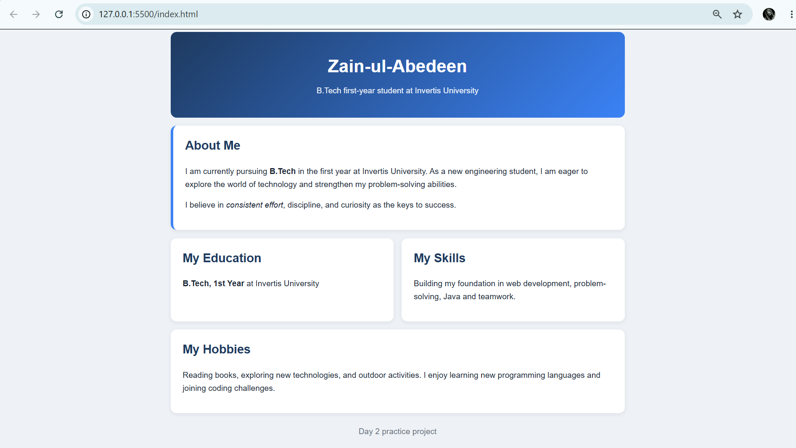

# Day 2: Personal Introduction Page

A personal introduction page built with HTML and CSS. It has a header, an About section, Education, Skills and Hobbies, all styled as cards.

## What I used

- HTML semantic tags: `header`, `main`, `section`, `footer`
- `id`, `class` and a `data-section` attribute on each section
- `strong` and `em` for emphasis
- CSS for the gradient header, card layout and a two-column grid

## How to open

1. Download or clone this repository.
2. Open `index.html` in any web browser.
3. To edit it, open the folder in VS Code and use the Live Server extension.

## Screenshot

